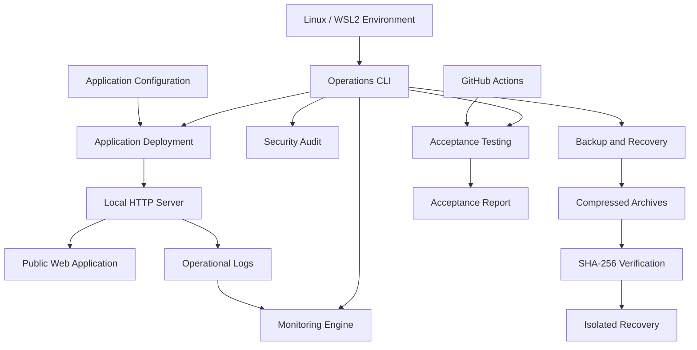

<div align="center">

# Linux Operations Lab

### DevOps Project 01 — Linux Fundamentals

**Build. Deploy. Monitor. Secure. Recover.**


A hands-on Linux engineering project covering application
deployment, operational monitoring, filesystem security,
Bash automation and disaster recovery.

</div>

---

## Overview

Linux Operations Lab demonstrates the fundamental
responsibilities of a DevOps engineer through a practical,
locally deployed web application and an automated
operational management toolkit.

Developed as part of the DecodeLabs DevOps
learning journey.

The project emphasizes reproducibility, least privilege,
operational visibility, evidence-based verification
and reliable recovery.

## Capabilities

| Capability | Implementation |
|---|---|
| Linux administration | Filesystem navigation and file management |
| Application deployment | Python HTTP server |
| Configuration management | External configuration file |
| Operational monitoring | HTTP health checks and log analysis |
| Live observability | Real-time log streaming |
| Security hardening | Ownership and permission management |
| Security auditing | Automated filesystem security checks |
| Backup engineering | Timestamped compressed archives |
| Integrity verification | SHA-256 checksums |
| Disaster recovery | Isolated restoration and comparison |
| Quality assurance | Automated acceptance testing |
| Continuous integration | GitHub Actions workflow |

## Architecture



## Technology Stack

- Linux / Ubuntu / WSL2
- Bash shell scripting
- Python standard library HTTP server
- HTML and CSS
- GNU Coreutils
- curl
- iproute2
- Git and GitHub Actions

No paid APIs or external Python libraries are required.

## Quick Start

### Prerequisites

A Linux environment with Bash, Python 3, curl,
iproute2, tar, Git and GNU Coreutils.

### Initialize

```bash
bash scripts/setup.sh
```

### Start the application

```bash
./scripts/ops.sh start
```

Open http://localhost:8095 in your browser.

The server runs in the foreground.
Use Ctrl+C to stop it.

### Verify deployment

In a second terminal:

```bash
./scripts/ops.sh status
./scripts/ops.sh audit
./scripts/ops.sh backup
./scripts/ops.sh verify
```

## Operations CLI

| Command | Description |
|---|---|
| `./scripts/ops.sh start` | Launch the application |
| `./scripts/ops.sh status` | Check application health |
| `./scripts/ops.sh monitor` | Display operational metrics |
| `./scripts/ops.sh logs` | Stream server logs |
| `./scripts/ops.sh audit` | Verify security permissions |
| `./scripts/ops.sh backup` | Generate verified backup |
| `./scripts/ops.sh recover` | Test isolated recovery |
| `./scripts/ops.sh verify` | Execute acceptance tests |
| `./scripts/ops.sh help` | Display command reference |

## Repository Structure

```text
.
├── .github/
│   └── workflows/
│       └── verify.yml
├── app/
│   ├── config.example.conf
│   └── index.html
├── scripts/
│   ├── setup.sh
│   ├── start.sh
│   ├── monitor.sh
│   ├── live-logs.sh
│   ├── security-audit.sh
│   ├── backup.sh
│   ├── recovery-test.sh
│   ├── verify.sh
│   └── ops.sh
├── docs/
│   ├── ARCHITECTURE.md
│   ├── LINUX-COMMANDS.md
│   ├── evidence/
│   └── screenshots/
├── .gitignore
├── SECURITY.md
└── README.md
```

Configuration, runtime logs, backups and other
generated operational files are excluded from Git.

## Security Architecture

| Asset | Linux permission |
|---|---|
| Local configuration | 600 |
| Operational logs | 640 |
| Application files | 644 |
| Executable scripts | 750 |
| Backup directory | 700 |
| Evidence directory | 700 |
| Public directory | 755 |

The application binds to localhost and serves only
the designated public directory.

Configuration files, operational logs and backups
remain outside the HTTP document root.

## Backup and Recovery

```bash
./scripts/ops.sh backup
./scripts/ops.sh recover
```

Backups include application source, configuration,
public assets and operational scripts.

Each archive is accompanied by a SHA-256 checksum.
The recovery test extracts files into an isolated
directory and compares them against the current source.

This validates file recovery without overwriting
the running application.

## Testing and Verification

The automated test suite covers:

- Filesystem structure
- Configuration validation
- Application availability
- HTTP response validation
- Network binding
- Sensitive file exposure
- Bash syntax and execution
- Security permissions
- Backup integrity
- Isolated recovery

See the recorded local test results:

- [Acceptance report](docs/evidence/acceptance-report.txt)
- [Security audit](docs/evidence/security-audit.txt)

## Continuous Integration

The GitHub Actions workflow initializes the project,
starts the application, creates a verified backup,
and executes acceptance and security tests.

## Documentation

- [Technical architecture](docs/ARCHITECTURE.md)
- [Linux command reference](docs/LINUX-COMMANDS.md)
- [Security policy](SECURITY.md)

## Learning Outcomes

This project demonstrates practical experience in:

- Linux system administration
- Shell scripting and automation
- Application deployment
- Log analysis and troubleshooting
- Filesystem security
- Backup integrity and recovery
- Continuous integration
- Technical documentation

## Limitations

This is a local DevOps training environment.

The Python HTTP server is intended for development
and demonstration, not production internet hosting.

The project does not implement production-grade
authentication, TLS termination or high availability.

---

<div align="center">

**DecodeLabs — DevOps Engineering Journey**

Project 01 / Linux Fundamentals

</div>
